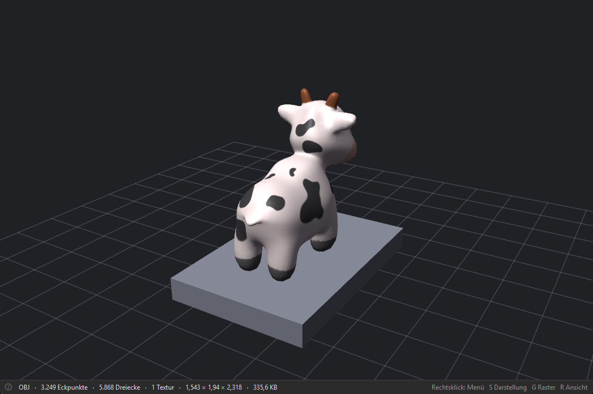

# 3divi

[English](README.md) | **Deutsch**

Ein 3D-Modell-Viewer (Lister-Plugin) für den [Total Commander](https://www.ghisler.com), 32 und 64 Bit.
F3 auf einer 3D-Datei, und du drehst sie mit der Maus: STL, OBJ mit Materialien und Texturen, PLY, OFF, LDraw, glTF, FBX, 3DS, DXF, 3MF, Collada und mehr.
Große Modelle laden im Hintergrund, Vorschaubilder erscheinen in der Miniaturansicht des Total Commander, und ein Modell lässt sich in ein anderes Format speichern. Natives Direct3D 11, außer dem Plugin muss nichts installiert werden.

## Unterstützte Dateien

- **STL** (binär und ASCII), **OBJ** (mit `.mtl`-Farben und `map_Kd`-Texturen, Vierecke und Vielecke, negative Indizes), **PLY** (ASCII und binär, Vertexfarben und Normalen, Dreiecksstreifen, Punktwolken), **OFF** (auch mit Farben)
- **LDraw:** `.ldr`, `.mpd` (mehrere Dateien in einer), `.dat` – die Teile kommen aus deiner LDraw-Bibliothek (siehe unten)
- **glTF** und **GLB**, **FBX**, **3DS**, **DXF**, **LWO** und **LWS** (LightWave), **AC** (AC3D), **ASE**, **DAE** (Collada), **3MF**, **AMF**, **X3D**, **MS3D**, **MD2**, **MD3**, **MD5MESH**, **MDC**, **COB**, **XGL**, **Q3O**, **Q3S**, **PMX**, **OGEX**

Dateien mit einer mehrfach verwendeten Endung werden am Inhalt erkannt. Eine `configure.ac` oder eine fremde `.dat`-Datei öffnet sich deshalb weiter als Text. DXF-Dateien, die nur 2D-Zeichnungen enthalten (Linien, Bögen, Text), überlässt 3divi dem nächsten Lister-Plugin.

## Funktionen

- **Maus:** Ziehen = drehen, Ziehen mit rechter oder mittlerer Taste (oder Umschalt+Ziehen) = verschieben, Mausrad = zoomen, Doppelklick = ins Fenster einpassen
- **Darstellungen** (Taste S): *Fläche*, *Punkte*, *Kanten*, *Verdeckte Punkte*, *Verdeckte Linien*, *Fläche und Kanten*
- **Texturen und Materialien:** OBJ-Materialien und -Texturen, eingebettete und externe Texturen von glTF/FBX/3DS und anderen, Vertexfarben
- **Glättung:** Normalen der Datei behalten, flach (Facetten), 30°, 60° oder vollständig glatt – Flächen innerhalb des Winkels teilen sich eine glatte Normale
- **Optimieren:** verschmilzt identische Eckpunkte und entfernt entartete Dreiecke
- **Licht:** folgt der Kamera oder steht fest in der Szene; heller oder dunkler
- **Transformieren:** um X, Y oder Z um 90° drehen, Oben-Achse wechseln (Z oben bei STL, PLY, 3DS, DXF; Y oben bei OBJ, glTF) – auf Wunsch je Dateiformat gemerkt (*Oben-Achse bei DXF-Dateien immer wechseln*) –, zurücksetzen
- **Ansichten:** vorne, hinten, links, rechts, oben, unten (Ziffernblock), Achsen, Raster, Rückseiten ausblenden, Anti-Aliasing, optional FPS-Anzeige
- **Symbolleiste:** die Ansichten, das Drehen um 90°, der Wechsel der Oben-Achse, Zurücksetzen, Darstellung, Raster und Achsen als Buttons, dazu ein Button für das ganze Menü (Taste O blendet sie aus oder ein)
- **Vorige / nächste Datei:** Bild↑ / Bild↓ (oder die Pfeil-Buttons in der Symbolleiste) zeigen die vorige oder nächste Datei des Ordners, die 3divi unterstützt, in natürlicher Namensreihenfolge
- **Speichern unter** STL, OBJ oder PLY im Kontextmenü – mit deiner Drehung, die Oben-Achse wird für das Zielformat umgerechnet
- **Textur laden** (Kontextmenü) legt ein beliebiges Bild (PNG, JPG, BMP, TGA, ...) aus einem Dateidialog im Ordner des Modells auf das Modell, praktisch für Modelle mit mehreren Texturen
- **Bild kopieren** (Strg+C) legt die aktuelle Ansicht in die Zwischenablage
- **Vorschaubilder** in der Miniaturansicht des Total Commander (Dateien bis 96 MB)
- **Laden im Hintergrund** mit Fortschrittsanzeige, auch große Modelle lassen den Total Commander nicht einfrieren
- Statusleiste mit Dateiname (abschaltbar), Format, Eckpunkten, Dreiecken, Texturen, Maßen und Dateigröße
- Helles und dunkles Design im Windows-11-Look (automatisch wie Windows oder fest); deutsche und englische Oberfläche

## Download und Installation

1. **`3divi.zip`** aus dem [neuesten Release](https://github.com/naderi/tc-3divi/releases/latest) herunterladen.
2. Die ZIP-Datei im Total Commander öffnen (Enter auf der Datei) und die Frage nach der Installation des Plugins bestätigen.

Die Einstellungen stehen in `3divi.ini` neben dem Plugin: `Mode`, `Grid`, `Axes`, `Bar`, `Toolbar`, `FileName`, `AA`, `Cull`, `Fps`, `Light`, `Gain`, `SwapUp_<FORMAT>` (z. B. `SwapUp_DXF=1`), `Theme` (0 automatisch, 1 hell, 2 dunkel) und `Language` (`de` oder `en`, sonst wie Windows).

**Wenn du auch TreeView nutzt:** Beide Plugins öffnen `.dae`-Dateien. Stelle 3divi in der Liste der Lister-Plugins vor TreeView (*Konfigurieren > Optionen > Plugins*), dann öffnen sich Collada-Modelle hier, und andere XML-Dateien mit der Endung `.dae` gehen weiter an TreeView.

**LDraw:** Für die Teile von LDraw-Modellen braucht 3divi die [LDraw-Teilebibliothek](https://www.ldraw.org). Sie wird in den üblichen Ordnern automatisch gefunden (`C:\LDraw`, `%USERPROFILE%\LDraw`, `C:\Program Files\LDraw`, die Studio-Installation); sonst gibst du `LDrawPath=` in `3divi.ini` oder die Umgebungsvariable `LDRAWDIR` an. Modelle, die alle ihre Teile enthalten (`.mpd`), laufen auch ohne.

## Tasten

| Taste | Aktion |
|---|---|
| Rechtsklick, Menütaste | Kontextmenü mit allen Funktionen |
| S | Nächste Darstellung |
| G / A / B / O | Raster / Achsen / Statusleiste / Symbolleiste |
| T | Design: automatisch, hell, dunkel |
| U | Oben-Achse wechseln (Z oder Y) |
| X / Y / Z (+Umschalt) | Um 90° drehen (Umschalt: andere Richtung) |
| R, Pos1, Num 0, Doppelklick | Ins Fenster einpassen |
| Num 1, Num 3, Num 7 (+Strg) | Vorne, rechts, oben (Strg: hinten, links, unten) |
| Pfeiltasten, + / − | Drehen, zoomen |
| Bild↑ / Bild↓ | Vorige / nächste Datei des Ordners |
| Strg+C | Bild kopieren |
| F1 | Info |

Alle anderen Tasten (Esc, N/P für die nächste und vorige Datei, F-Tasten …) gehen an den Total Commander.

## Lizenz

Freeware – frei nutzbar, aber **nicht zum Verkauf**. Siehe [LICENSE](LICENSE). 3divi enthält die [Open Asset Import Library](https://github.com/assimp/assimp) (BSD), zlib und weitere Open-Source-Komponenten; ihre Lizenzen stehen in `THIRD-PARTY-LICENSES.txt` im Download.

## Unterstützung

Wenn 3divi dir Zeit spart, kannst du die Entwicklung auf Ko‑fi unterstützen. ☕

---

© 2026 [Ali Naderi](https://github.com/naderi) · [digitalent.dev](https://digitalent.dev/de/)
