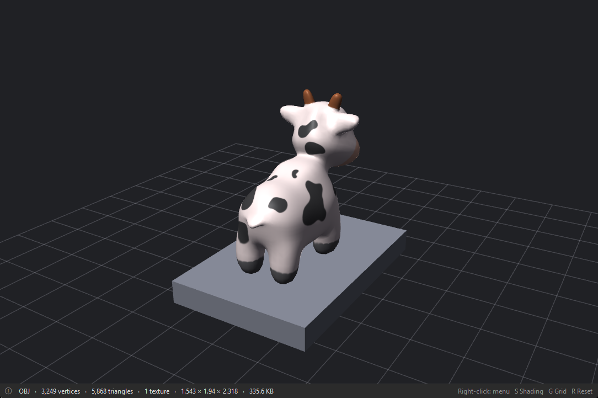

# 3divi

**English** | [Deutsch](README.de.md)

A 3D model viewer (Lister plugin) for [Total Commander](https://www.ghisler.com), 32 and 64 bit.
Press F3 on a 3D file and turn it around with the mouse: STL, OBJ with materials and textures, PLY, OFF, LDraw, glTF, FBX, 3DS, DXF, 3MF, Collada and more.
Large models load in the background, thumbnails show up in Total Commander's thumbnail view, and you can save a model in another format. Native Direct3D 11, nothing to install besides the plugin.

## Supported files

- **STL** (binary and ASCII), **OBJ** (with `.mtl` colours and `map_Kd` textures, quads and polygons, negative indices), **PLY** (ASCII and binary, vertex colours and normals, triangle strips, point clouds), **OFF** (also with colours)
- **LDraw:** `.ldr`, `.mpd` (several files in one), `.dat` – the parts come from your LDraw library (see below)
- **glTF** and **GLB**, **FBX**, **3DS**, **DXF**, **LWO** and **LWS** (LightWave), **AC** (AC3D), **ASE**, **DAE** (Collada), **3MF**, **AMF**, **X3D**, **MS3D**, **MD2**, **MD3**, **MD5MESH**, **MDC**, **COB**, **XGL**, **Q3O**, **Q3S**, **PMX**, **OGEX**

Files with a shared extension are recognized by their content, so a `configure.ac` or an unrelated `.dat` file still opens as text.

## Features

- **Mouse:** drag = orbit, right or middle drag (or Shift+drag) = pan, wheel = zoom, double-click = fit to the window
- **Shading modes** (key S): *Solid*, *Points*, *Edges*, *Hidden points*, *Hidden lines*, *Solid and edges*
- **Textures and materials:** OBJ materials and textures, embedded and external textures of glTF/FBX/3DS and others, vertex colours
- **Smoothing:** keep the normals of the file, flat (facets), 30°, 60° or fully smooth – faces within the angle share a smooth normal
- **Optimize:** welds identical vertices and removes degenerate triangles
- **Light:** follows the camera or stays fixed in the scene; brighter or darker
- **Transform:** rotate by 90° around X, Y or Z, switch the up axis (Z-up for STL, PLY, 3DS, DXF; Y-up for OBJ, glTF), reset
- **Views:** front, back, left, right, top, bottom (numeric keypad), axes, grid, back-face culling, anti-aliasing, optional FPS display
- **Save as** STL, OBJ or PLY from the context menu – including your rotation, with the up axis converted for the target format
- **Copy image** (Ctrl+C) puts the current view on the clipboard
- **Thumbnails** in Total Commander's thumbnail view (files up to 96 MB)
- **Background loading** with a progress display, so even large models never freeze Total Commander
- Status bar with format, vertices, triangles, textures, size and file size
- Light and dark design in the Windows 11 look (automatic like Windows, or fixed); English and German interface

## Download and installation

1. Download **`3divi.zip`** from the [latest release](https://github.com/naderi/tc-3divi/releases/latest).
2. Open the ZIP in Total Commander (Enter on the file) and confirm the question whether to install the plugin.

Settings are stored in `3divi.ini` next to the plugin: `Mode`, `Grid`, `Axes`, `Bar`, `AA`, `Cull`, `Fps`, `Light`, `Gain`, `Theme` (0 automatic, 1 light, 2 dark) and `Language` (`de` or `en`, otherwise like Windows).

**If you also use TreeView:** both plugins open `.dae` files. Put 3divi before TreeView in the list of Lister plugins (*Configuration > Options > Plugins*), then Collada models open here, while other XML files with the `.dae` extension still go to TreeView.

**LDraw:** for the parts of LDraw models 3divi needs the [LDraw parts library](https://www.ldraw.org). It is found automatically in the usual folders (`C:\LDraw`, `%USERPROFILE%\LDraw`, `C:\Program Files\LDraw`, the Studio installation); otherwise set `LDrawPath=` in `3divi.ini` or the environment variable `LDRAWDIR`. Models that contain all their parts (`.mpd`) work without it.

## Keys

| Key | Action |
|---|---|
| Right click, Menu key | Context menu with all functions |
| S | Next shading mode |
| G / A / B | Grid / axes / status bar |
| T | Theme: automatic, light, dark |
| U | Switch the up axis (Z or Y) |
| X / Y / Z (+Shift) | Rotate by 90° (Shift: other way) |
| R, Home, Num 0, double-click | Fit to the window |
| Num 1, Num 3, Num 7 (+Ctrl) | Front, right, top (Ctrl: back, left, bottom) |
| Arrow keys, + / − | Orbit, zoom |
| Ctrl+C | Copy the image |
| F1 | About |

All other keys (Esc, N/P for the next and previous file, F-keys …) go to Total Commander.

## License

Freeware – free to use, but **not for sale**. See [LICENSE](LICENSE). 3divi contains the [Open Asset Import Library](https://github.com/assimp/assimp) (BSD), zlib and other open-source components; their licenses are in `THIRD-PARTY-LICENSES.txt` in the download.

## Support

If 3divi saves you time, you can support its development on Ko‑fi. ☕

---

© 2026 [Ali Naderi](https://github.com/naderi) · [digitalent.dev](https://digitalent.dev/en/)
